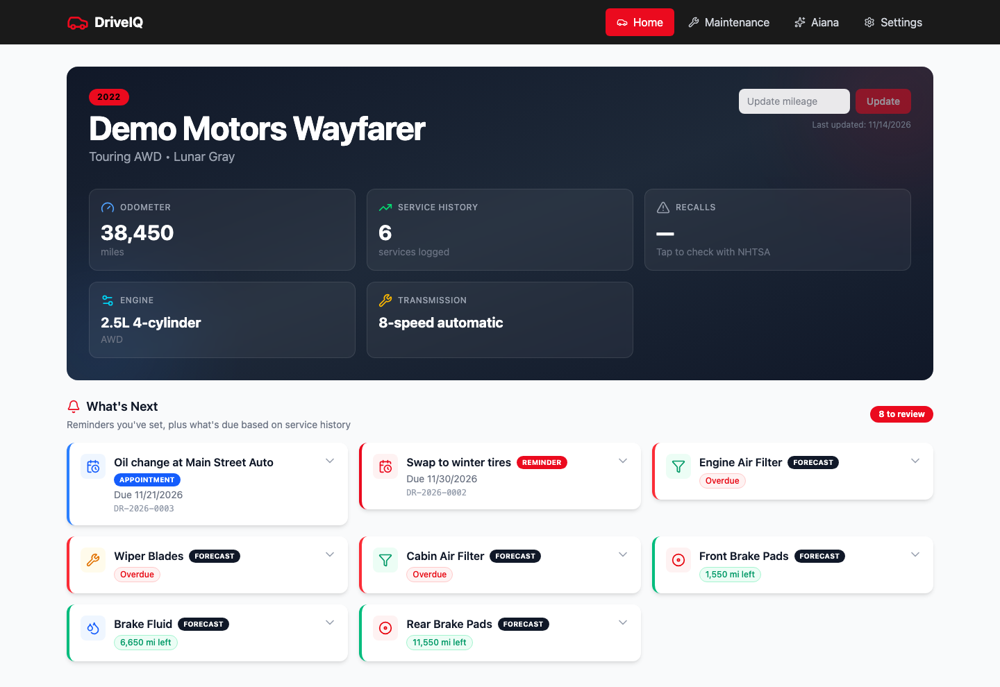
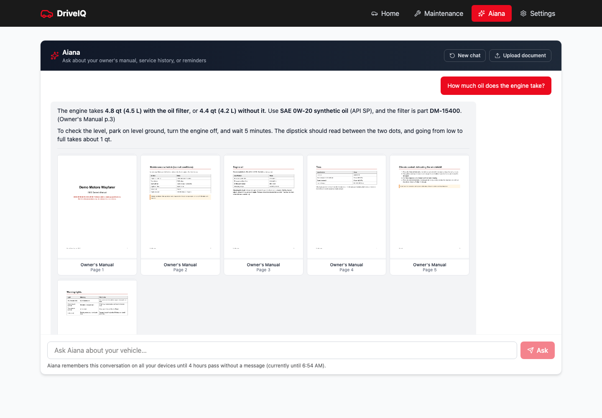

<p align="center"></p>

# DriveIQ

Your vehicle's service history, reminders and manuals in one place, with **Aiana**, an assistant that answers from your own documents and cites the page. DriveIQ runs on your own Cloudflare account, behind a login only you can pass.

[](https://deploy.workers.cloudflare.com/?url=https://github.com/ry-ops/DriveIQ)

**Before you click:** read [docs/SETUP.md](docs/SETUP.md). You'll need an Anthropic API key, and DriveIQ stays locked until you turn on Cloudflare Access (a two-minute step the guide walks through).

<p align="center"></p>

## What it does

- **What's Next**: reminders and booked appointments, plus a forecast of each service on your maintenance schedule, by mileage and date.
- **Service history**: log what was done, when, at what mileage, and by whom.
- **Aiana**: ask about your vehicle in plain language. It searches your owner's manual and other documents, uses your service history and schedule, and shows the pages it answered from. It can also add or change reminders when you ask.
- **Your schedule, your specs**: the maintenance schedule starts with general intervals that you match to your owner's manual, and exact specs you confirm (oil capacity, part numbers) win over anything else.
- **Recalls**: one tap checks NHTSA for recalls on your make, model and year.

<p align="center"></p>

## How it's built

One Cloudflare Worker serves the app and its API:

| Piece | Cloudflare product |
|---|---|
| App (React) and API (Hono) | Workers, with static assets |
| Vehicle, service history, reminders, schedule | D1 |
| Page images of your documents | R2 |
| Document search | Vectorize, with Workers AI embeddings (`bge-base-en-v1.5`) |
| Aiana's answers | Claude (Haiku 5.5 by default) through AI Gateway |
| Login | Cloudflare Access, verified by the Worker on every API request |

Your documents are read in your browser and never leave your Cloudflare account, except for the excerpts sent to Claude with each question.

## Upgrading from v1

v2 is a new app on a new platform. **v1.3.1 is the last Docker release**, still available from [the releases page](https://github.com/ry-ops/DriveIQ/releases/tag/v1.3.1). There's no automatic migration: deploy v2, add your vehicle, re-upload your documents, and re-enter your service history. See [CHANGELOG.md](CHANGELOG.md) for what changed.

## Development

```sh
npm install
npm test            # Worker tests
npm run typecheck   # Worker and UI
npm run build       # UI into dist/
npm run dev         # local Worker + UI (see docs/SETUP.md → Local development)
```

## License

[MIT](LICENSE)
